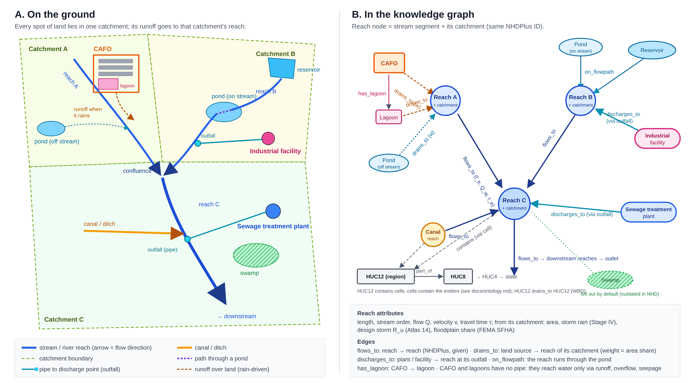

# Knowledge-graph ontology

Version 0.1. Node types, relations and rules of the hydrological knowledge graph for
pollution sources (CAFOs, sewage treatment plants, industrial facilities, cropland) and
the water they reach. A machine-readable copy is in `configs/ontology.yaml`.



## 1. Design principles

1. **Hierarchical, following OGC HY_Features.** Water is organised as catchments that nest
   (HUC4 ⊃ HUC8 ⊃ HUC12 ⊃ reach catchment) and are connected by flow. A *reach* is the
   HY_Features *flowpath* together with its *catchment area*.
2. **Two branches above the grid.** Watersheds (HUC4 → HUC8 → HUC12) and the
   administrative branch (state) do not nest in each other (a HUC4 can cross a state
   line), so both point down to the grid separately.
3. **A uniform spatial layer.** H3 hexagon cells carry *all* spatial relations, and
   only two kinds: `contains` (yes/no) and `adjacent` (yes/no). Distance over land is the
   number of `adjacent` hops.
4. **Hydrology is separate from space.** Water movement uses its own typed relations
   (`flows_to`, `drains_to`, `discharges_to`, …). Two adjacent cells need not be connected
   by water (e.g. across a ridge). Distance along water is the number of `flows_to` hops
   between equal-length segments.
5. **Location quality decides the level.** An entity is contained by the finest cell its
   location supports; an imprecise location attaches to a coarse cell.
6. **Time-varying values are attributes, not nodes.** Yearly discharge, operating status
   and daily rainfall are stored per (node, time).

## 2. Levels

```
 Hydrologic branch                Administrative branch
 L1  V_huc4                        V_state
 L2   └─ V_huc8                       │
 L3       └─ V_huc12                  │
           └──────── contains ────────┘
 L4                 V_cell (coarse, H3 resolution 7)
 L5                   └─ V_cell (fine, H3 resolution 8)   ◀── adjacent ──▶
                            │ contains
 L6  Entities: water bodies, reaches (→ segments), sources (→ lagoons, outfalls), stations
```

## 3. Node types

Every node has a unique `id` of the form `<type>:<key>`.

### Regions

| Type | Definition | Source | Key | Rule |
|---|---|---|---|---|
| **V_state** | US state | — | postal code (`state:NC`) | NC, CA, IA |
| **V_huc4** | 4-digit hydrologic unit (subregion) | WBD | HUC4 code | units touching a study state |
| **V_huc8** | 8-digit hydrologic unit (subbasin) | WBD | HUC8 code | inside a V_huc4 |
| **V_huc12** | 12-digit hydrologic unit (subwatershed, ~100 km²) | WBD | HUC12 code | inside a V_huc8 |

### Grid

| Type | Definition | Key | Rule |
|---|---|---|---|
| **V_cell** | H3 hexagon. Attribute `res`: 7 (coarse, ~5.2 km²) or 8 (fine, ~0.74 km², ~460 m edge) | H3 index (`cell:882a1072b5fffff`) | every cell that contains an entity, plus the cells between them inside the study HUC12s |

### Water

| Type | Definition | Source | Key | Inclusion rule |
|---|---|---|---|---|
| **V_reach** | stream, river or canal flowline **with its catchment** (HY_Features flowpath + catchment) | NHDPlus HR `NHDFlowline` + `NHDPlusCatchment` | NHDPlusID | FType StreamRiver, ArtificialPath, CanalDitch, Connector, Pipeline, UndergroundConduit; not Coastline |
| **V_segment** | fixed-length piece of a reach (default 500 m; the last piece may be shorter) | derived from V_reach | `<NHDPlusID>-<n>` | every reach is cut from its upstream end |
| **V_pond** | small standing water | NHDWaterbody | Permanent_Identifier | FType 390 (LakePond) with area < 8 ha; also FType 436 with FCode 43612/43624 (sewage/treatment pond, attribute `treatment = true`) |
| **V_lake** | large standing water | NHDWaterbody | Permanent_Identifier | FType 390 with area ≥ 8 ha |
| **V_reservoir** | dammed or constructed reservoir | NHDWaterbody | Permanent_Identifier | FType 436, except FCodes 43612/43624 |
| **V_wetland** | swamp or marsh | NHDWaterbody | Permanent_Identifier | FType 466; optional (NHD outlines are often outdated in NC) |
| **V_estuary** | estuary, the coastal end of rivers | NHDWaterbody | Permanent_Identifier | FType 493 |

### Sources

| Type | Definition | Source | Key | Inclusion rule |
|---|---|---|---|---|
| **V_cafo** | animal feeding operation | NC DEQ (NC), Iowa DNR (IA), Cal-FF (CA) | state permit / facility ID | the state list only (see `docs/data_sources.md`, `sources`) |
| **V_lagoon** | CAFO waste lagoon | NC DEQ lagoon counts; lagoon points when available | `<cafo key>:<n>` | one per reported lagoon |
| **V_sewage** | sewage treatment plant: POTWs and private domestic-sewage plants | ECHO + DMR | NPDES ID | `source_type = Sewage treatment plant` in `sources` |
| **V_indus** | industrial facility discharging process or cooling wastewater | ECHO + DMR | NPDES ID | `source_type = Industrial facility` in `sources` |
| **V_crop** | cropland field | to be provided | field ID | — |
| **V_outfall** | discharge point of a V_sewage or V_indus | ECHO `NPDES_PERM_FEATURE_COORDS` | `<NPDES ID>-<outfall no.>` | coordinates converted from packed DMS; dropped if > 5 km from the facility |

### Observation

| Type | Definition | Source | Key | Inclusion rule |
|---|---|---|---|---|
| **V_station** | water-quality sampling station | WQP | MonitoringLocationIdentifier | at least one nitrogen, ammonia or E. coli result |

## 4. Relations

### Spatial (only through cells)

| Relation | Domain → Range | Cardinality | Meaning and rule |
|---|---|---|---|
| **contains** | V_huc4 → V_huc8, V_huc8 → V_huc12 | 1 → many | WBD nesting (code prefix) |
| **contains** | V_huc12 → V_cell (res 7 and 8) | 1 → many | each cell belongs to the HUC12 that contains its **centre** (exactly one) |
| **contains** | V_state → V_cell | 1 → many | each cell belongs to the state that contains its centre |
| **contains** | V_cell (res 7) → V_cell (res 8) | 1 → 7 | H3 parent → children |
| **contains** | V_cell → any entity | many ↔ many | the entity lies (at least partly) in the cell; points: one cell; lines and polygons: every cell they overlap |
| **adjacent** | V_cell ↔ V_cell | symmetric | the two cells share an edge; same resolution only (6 neighbours; 5 at the 12 H3 pentagons) |

### Hydrological

| Relation | Domain → Range | Attributes | Meaning and rule |
|---|---|---|---|
| **flows_to** | V_reach → V_reach | `f_e`, `Q_w`, `τ_e` | NHDPlusFlow (FromNHDPID → ToNHDPID); f_e = QAMA share of the downstream branches (DivFrac is empty in NHDPlus HR) |
| **flows_to** | V_segment → V_segment | `length_m` | consecutive segments of a reach; the last segment of a reach → first segment of each downstream reach |
| **contains** | V_reach → V_segment | | linear decomposition of the reach |
| **drains_to** | V_cafo, V_lagoon, V_crop, V_pond (off stream), V_wetland → V_reach | `weight` | runoff path: the reach of the catchment the source lies in; weight = area share (sums to ≤ 1 per source) |
| **discharges_to** | V_outfall → V_segment | `snap_m` | the outfall's nearest segment of the network (StreamRiver, ArtificialPath, CanalDitch, Connector) within 500 m |
| **on_flowpath** | V_pond, V_lake, V_reservoir, V_estuary → V_reach | | a reach runs through the water body (NHDFlowline `WBArea_Permanent_Identifier`) |
| **drains_to** | V_huc12 → V_huc12 | | WBD `tohuc` |
| **observes** | V_station → V_segment | `snap_m` | the station samples that segment (nearest network segment within 250 m) |

### Ownership

| Relation | Domain → Range | Meaning |
|---|---|---|
| **has_lagoon** | V_cafo → V_lagoon | the lagoon belongs to the farm |
| **has_outfall** | V_sewage, V_indus → V_outfall | the outfall belongs to the facility (one facility can have several) |

## 5. Rules and constraints

1. **Placement.** Every entity with coordinates is `contains`-linked from at least one
   cell. Attribute `loc_quality`: `exact` (outfall, CAFO list point, NHD geometry) → res-8
   cell; `approximate` (EPA geocode of a facility address) → res-8 cell plus its res-7
   parent; `poor` (geocode at town level, or > 2 km from its own outfall) → res-7 cell only.
2. **Tree above the grid.** Each res-8 cell has exactly one res-7 parent, one V_huc12 and
   one V_state; each V_huc12 one V_huc8; each V_huc8 one V_huc4.
3. **Acyclic flow.** `flows_to` between reaches must go from higher to lower HydroSeq; the
   reach network is a directed acyclic graph.
4. **Split conservation.** For every reach with outgoing `flows_to` edges, Σ f_e = 1.
5. **Drainage weights.** For every source, Σ weight of its `drains_to` edges ≤ 1; the rest
   falls in sink catchments or outside the study area.
6. **Pipes only from outfalls.** V_sewage and V_indus reach water only through
   `has_outfall` → `discharges_to`. A facility without outfall coordinates gets a
   provisional outfall at its own point (`loc_quality = poor`).
7. **No pipes from farms.** V_cafo, V_lagoon and V_crop reach water only through
   `drains_to` (runoff, overflow, seepage); they have no outfall.
8. **Time.** Nodes are static. Per-year values (`status`, `discharge`, loads) are stored
   per (node, year); per-day rainfall per (V_cell, date); the design storm R_u per V_cell.
9. **IDs are stable** across years and rebuilds (source IDs, NHDPlusID, H3 index, HUC codes).

## 6. Distance from structure alone

| Distance | Computed as | Accuracy |
|---|---|---|
| Straight-line (over land) | `adjacent` hops between the res-8 cells containing the two nodes × ~0.8 km (centre-to-centre spacing) | ± one cell (~0.5 km) |
| Along the water | `flows_to` hops between V_segments × segment length | ± one segment (500 m) |
| Coarse closeness | lowest common region (same HUC12 / HUC8 / HUC4 / state) | categorical |

Exact lengths stay available as edge attributes (`length_m`, `τ_e`).

## 7. Attributes (main ones)

| Node | Attributes |
|---|---|
| V_reach | ftype, length_km, stream_order, hydroseq, q_m3s, v_ms, tau_s, catchment_km2 |
| V_segment | length_m, position along reach |
| V_pond / V_lake / V_reservoir / V_wetland / V_estuary | area_m2, fcode, on_network, treatment (ponds) |
| V_cafo | animal type, animal_count, permit, status per year |
| V_lagoon | location_from (`CAFO point` / `lagoon point`) |
| V_sewage / V_indus | industry, status, discharge, flow_mgd, nitrogen_kg, ammonia_kg, bacteria_count, total_waste_kg per year |
| V_outfall | outfall number, receiving water |
| V_station | results per parameter and date (standardised units) |
| V_cell | res; per date: storm rainfall (Stage IV); R_u (Atlas 14); SFHA share (FEMA) |
| V_huc12 | name, area |

## 8. Parameters (to confirm)

| Parameter | Default |
|---|---|
| H3 fine / coarse resolution | 8 / 7 |
| Segment length | 500 m |
| Pond / lake area threshold | 8 ha |
| Outfall snap distance | 500 m |
| Station snap distance | 250 m |
| Include V_wetland | no |

## 9. Correspondence with HY_Features

| This ontology | HY_Features |
|---|---|
| V_reach (catchment part), V_huc12/8/4 | HY_Catchment (nested; HUCs as catchment aggregates) |
| V_reach (line part), V_segment | HY_Flowpath |
| confluences (ends of `flows_to`) | HY_HydroNexus |
| V_pond, V_lake, V_reservoir, V_estuary | HY_HydroFeature water bodies |
| V_outfall, V_station | HY_HydrometricFeature / hydrologic locations on the network |
